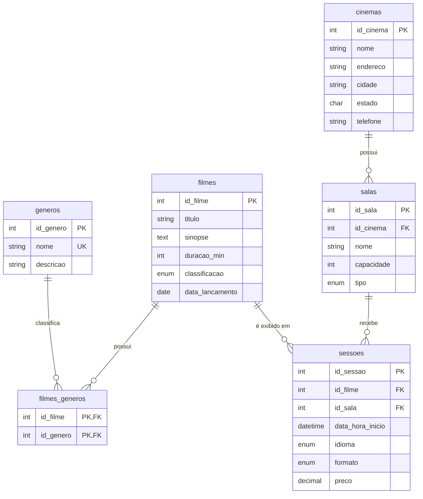

# 🎬 Sistema de Cinema


Aplicativo desktop em Python para gerenciar a programação de um cinema: gêneros, cinemas, salas, filmes e sessões, com os dados guardados em um banco MySQL.

## Sumário

- [Sobre o projeto](#sobre-o-projeto)
- [Funcionalidades](#funcionalidades)
- [Tecnologias](#tecnologias)
- [Como rodar](#como-rodar)
- [Configuração](#configuração)
- [Como usar](#como-usar)
- [Estrutura do projeto](#estrutura-do-projeto)
- [Banco de dados](#banco-de-dados)
- [Adicionando um novo cadastro](#adicionando-um-novo-cadastro)
- [Solução de problemas](#solução-de-problemas)
- [Padrão de commits](#padrão-de-commits)
- [Melhorias futuras](#melhorias-futuras)
- [Documentação](#documentação)
- [Autor](#autor)

## Sobre o projeto

O sistema cadastra os cinco elementos de uma programação de cinema e os liga entre si:

- um **cinema** tem várias **salas**;
- um **filme** tem um ou mais **gêneros** (relação N:N, resolvida pela tabela associativa `filmes_generos`);
- uma **sessão** liga um filme a uma sala em um horário, com idioma, formato e preço.

O código é dividido em três camadas (telas, repositórios e banco), e a tela de CRUD é genérica: cada cadastro novo só declara os seus campos.

## Funcionalidades

- CRUD completo de gêneros, cinemas, salas, filmes e sessões
- Filmes com vários gêneros
- Sessões com filme, sala, horário, idioma, formato e preço
- Busca instantânea em todas as listas
- Validação de campos obrigatórios, números e datas
- Mensagens claras para item em uso e registro duplicado
- Banco e tabelas criados automaticamente na primeira execução
- Dados de exemplo carregados com um comando
- Interface nas cores roxo e amarelo

## Tecnologias

| Item | Uso |
| --- | --- |
| Python 3.10+ | Linguagem do projeto |
| Tkinter / ttk | Interface gráfica (biblioteca padrão do Python) |
| MySQL 8+ | Banco de dados (InnoDB, `utf8mb4`) |
| mysql-connector-python | Driver de acesso ao MySQL |
| python-dotenv | Leitura das credenciais no arquivo `.env` |
| Git | Controle de versão, com um commit por funcionalidade |

## Como rodar

**Pré-requisitos:** Python 3.10 ou superior e MySQL 8 ou superior em execução.

1. Clone o repositório e entre na pasta:

   ```bash
   git clone <url-do-repositorio>
   cd cinepy
   ```

2. (Opcional) Crie e ative um ambiente virtual:

   ```bash
   python -m venv .venv
   ```

   | Sistema | Comando de ativação |
   | --- | --- |
   | Windows (prompt ou PowerShell) | `.venv\Scripts\activate` |
   | Windows (Git Bash) | `source .venv/Scripts/activate` |
   | Linux e macOS | `source .venv/bin/activate` |

3. Instale as dependências:

   ```bash
   python -m pip install -r requirements.txt
   ```

4. Crie o arquivo `.env` a partir do modelo e coloque a senha do seu MySQL:

   ```bash
   cp .env.example .env
   ```

   No Windows (prompt), use `copy .env.example .env`.

5. (Opcional) Carregue os dados de exemplo:

   ```bash
   python popular.py
   ```

6. Abra o sistema:

   ```bash
   python main.py
   ```

Na primeira execução, o banco `sist_cinema` e as tabelas são criados automaticamente a partir do `schema.sql`.

## Configuração

As credenciais ficam no arquivo `.env`, que não vai para o Git. Se uma variável faltar, vale o padrão da tabela.

| Variável | Padrão | Descrição |
| --- | --- | --- |
| `MYSQL_HOST` | `localhost` | Endereço do servidor MySQL |
| `MYSQL_PORT` | `3306` | Porta do servidor |
| `MYSQL_USER` | `root` | Usuário do MySQL |
| `MYSQL_PASSWORD` | vazio | Senha do usuário |
| `MYSQL_DATABASE` | `sist_cinema` | Nome do banco. Mantenha o padrão, pois o `schema.sql` sempre cria `sist_cinema` |

### Dados de exemplo

| Comando | O que faz |
| --- | --- |
| `python popular.py` | Carrega 9 gêneros, 10 filmes, 3 cinemas, 7 salas e 17 sessões. Só roda se o banco estiver vazio. |
| `python popular.py --limpar` | Apaga todos os dados e carrega os de exemplo de novo. |

## Como usar

Cada aba tem o formulário à esquerda e a lista à direita. Cadastre nesta ordem, porque uma tela depende da anterior: **Gêneros, Cinemas, Salas, Filmes e Sessões**.

| Para | Faça |
| --- | --- |
| Cadastrar | Preencha o formulário, sem nada selecionado na lista, e clique em **Salvar** |
| Editar | Clique na linha, altere os campos e clique em **Salvar** |
| Excluir | Clique na linha, clique em **Excluir** e confirme |
| Novo cadastro | Clique em **Novo** para limpar o formulário |
| Buscar | Digite na caixa **Buscar**; a lista filtra enquanto você digita |
| Vários gêneros num filme | Use Ctrl e clique nos gêneros |
| Datas | `dd/mm/aaaa`; nas sessões, `dd/mm/aaaa HH:MM` |
| Preço | Com vírgula ou ponto, como `25,50` |

Campos marcados com `*` são obrigatórios.

## Estrutura do projeto

```
cinepy/
├── main.py              ponto de entrada
├── config.py            leitura do .env
├── database.py          conexão, transação, consultar e executar
├── schema.sql           criação do banco e das tabelas
├── dados_exemplo.sql    dados de teste
├── popular.py           carrega os dados de exemplo
├── requirements.txt     dependências
├── .env.example         modelo das credenciais
├── repositorios/        SQL de cada tabela
│   ├── generos.py
│   ├── cinemas.py
│   ├── salas.py
│   ├── filmes.py
│   └── sessoes.py
└── telas/
    ├── tema.py          cores e estilos
    ├── janela.py        janela principal e abas
    ├── base.py          tela de CRUD genérica
    └── tela_*.py        uma tela por cadastro
```

Cada camada conversa só com a de baixo: **telas** → **repositórios** → **banco** (`database.py`). A camada de telas nunca escreve SQL.

## Banco de dados



### Regras principais

- `filmes_generos` é a tabela associativa N:N: o mesmo par filme e gênero não se repete.
- O nome de uma sala é único dentro do cinema, e uma sala não tem duas sessões no mesmo horário.
- Excluir um **cinema** apaga suas salas, e excluir uma **sala** apaga suas sessões (`CASCADE`).
- Não é possível excluir um **filme** que tem sessões, nem um **gênero** em uso (`RESTRICT`).

O dicionário de dados completo está na [documentação](#documentação), e o `schema.sql` é a fonte oficial da estrutura.

## Adicionando um novo cadastro

1. Crie a tabela no `schema.sql`.
2. Crie `repositorios/<nome>.py` com `listar`, `buscar`, `inserir`, `atualizar` e `excluir`.
3. Crie `telas/tela_<nome>.py` declarando `titulo`, `repo`, `colunas` e `campos`.
4. Registre a tela na lista `TELAS` do `telas/janela.py`.

O arquivo `telas/base.py` não precisa ser alterado.

## Solução de problemas

| Mensagem | Causa e solução |
| --- | --- |
| `ModuleNotFoundError: No module named 'mysql'` | Biblioteca fora do Python em uso. Ative o ambiente virtual e rode `python -m pip install -r requirements.txt`. |
| `1045 Access denied for user` | Usuário ou senha errados. Corrija `MYSQL_USER` e `MYSQL_PASSWORD` no `.env` e salve. |
| `Can't connect to MySQL server` | MySQL desligado ou host e porta errados. Inicie o serviço e confira `MYSQL_HOST` e `MYSQL_PORT`. |
| `Field 'id_genero' doesn't have a default value` | Tabela `filmes` de uma versão antiga do schema. Recrie o banco (apaga os dados): `python -c "import database; database.executar('DROP DATABASE sist_cinema'); database.criar_banco()"` |
| Não é possível excluir: item em uso | Há registros que dependem dele. Exclua antes as sessões do filme ou os filmes do gênero. |

## Padrão de commits

O projeto segue o padrão [Conventional Commits](https://www.conventionalcommits.org/pt-br/), com um commit por funcionalidade:

```
<tipo>(<escopo>): <descrição curta no imperativo>
```

| Tipo | Quando usar |
| --- | --- |
| `feat` | Funcionalidade nova |
| `fix` | Correção de erro |
| `chore` | Estrutura, configuração e dependências |
| `docs` | Documentação |
| `refactor` | Mudança de código sem mudar o comportamento |

Exemplos do histórico do projeto:

```
chore: estrutura inicial do projeto e conexão com MySQL
feat(banco): cria schema com tabelas e tabela associativa filmes_generos
feat(ui): janela principal com abas e tema roxo e amarelo
feat(crud): tela base de CRUD reutilizável e cadastro de gêneros
feat(filmes): CRUD de filmes com vários gêneros (tabela associativa N:N)
```

## Melhorias futuras

- Restrições `CHECK` para duração, capacidade e preço maiores que zero
- Bloquear sessões que se sobrepõem na mesma sala, considerando a duração do filme
- Pool de conexões, em vez de uma conexão por consulta
- Paginação nas listas
- Login e perfis de acesso

## Documentação

A documentação completa (especificações técnicas, requisitos, regras de negócio, estrutura do banco com diagramas e manual operacional) está em [`docs/Documentacao_Sistema_Cinema.docx`](docs/Documentacao_Sistema_Cinema.docx).

## Autor

Desenvolvido por [RUAN-SANTOS-22](https://github.com/RUAN-SANTOS-22).
